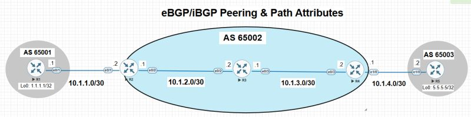

# BGP Lab 1: Peer Establishment & Packet-Level Analysis

A 5-router eBGP/iBGP topology built in EVE-NG (hosted on a Proxmox server) to study how BGP neighbors form and how path attributes behave, with the session captured in Wireshark.

## Objective

Understand BGP from what is actually on the wire and in the tables, not just the definitions:

- Watch a BGP session come up end to end (TCP, OPEN, KEEPALIVE, UPDATE)
- Read the path attributes in real `show ip bgp` output
- See why iBGP does not relay routes between iBGP peers
- See why next-hop behavior differs between eBGP and iBGP, and fix it

## Topology

| Router | AS | Loopback0 | Role |
|--------|-------|-----------|------|
| R1 | 65001 | 1.1.1.1/32 | eBGP edge |
| R2 | 65002 | 2.2.2.2/32 | AS boundary |
| R3 | 65002 | 3.3.3.3/32 | iBGP, middle |
| R4 | 65002 | 4.4.4.4/32 | AS boundary |
| R5 | 65003 | 5.5.5.5/32 | eBGP edge |

| Link | Subnet |
|------|--------|
| R1 - R2 | 10.1.1.0/30 |
| R2 - R3 | 10.1.2.0/30 |
| R3 - R4 | 10.1.3.0/30 |
| R4 - R5 | 10.1.4.0/30 |

R1 and R5 each peer eBGP with the edge of AS 65002. Inside AS 65002 the routers are connected in a line with iBGP sessions between neighbors.

## What I Worked Through

### 1. Session establishment, end to end

I captured the full session lifecycle in Wireshark: the TCP 3-way handshake on port 179, then OPEN in both directions, KEEPALIVEs, and UPDATE messages carrying the routes. On the router side I followed the FSM states: Idle, Connect, Active, OpenSent, OpenConfirm, Established.

*TCP SYN / SYN-ACK / ACK to port 179, followed by OPEN, KEEPALIVE, and UPDATE messages between 10.1.1.1 and 10.1.1.2.*

### 2. Path attributes in real output

Weight, Local Preference, AS_PATH, and Origin all behaved as expected once I read them from `show ip bgp` instead of from a definition table.

*R3's BGP table. Routes learned through iBGP carry LocPrf 100 and weight 0. The locally originated 3.3.3.3/32 has weight 32768.*

### 3. iBGP does not relay iBGP-learned routes

With a full underlying path, routers at either edge of AS 65002 could only see as far as the router directly connected to them. A route learned from one iBGP peer is not advertised to another iBGP peer (split horizon). This is the problem route reflectors solve, and it is what Lab 2 builds out.

### 4. eBGP rewrites next-hop, iBGP does not

When R2 learns 1.1.1.1/32 from R1 over eBGP, the next-hop is R1. R2 passes it to R3 over iBGP without changing it, so R3 sees a next-hop (10.1.1.1) that it has no route to. The route shows in the table but is not usable as best path.

In the R3 table above, `1.1.1.1/32` has next-hop `10.1.1.1` and is not marked best (`>`), while the iBGP routes with reachable next-hops are.

**Fix:** `next-hop-self` on the boundary router for its iBGP neighbors.

After the fix, the NEXT_HOP field in the UPDATE message changes value, confirmed in Wireshark:

![UPDATE
