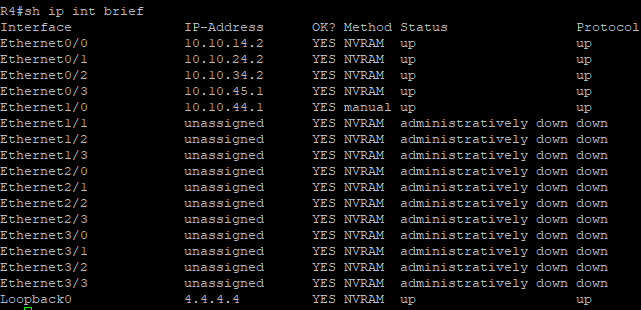
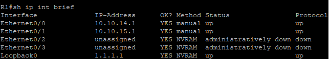
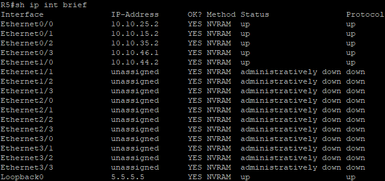
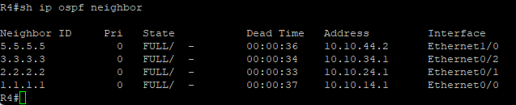
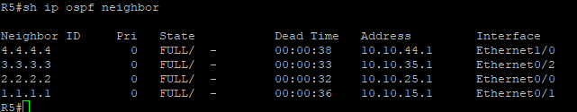
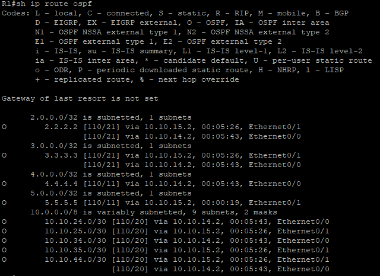
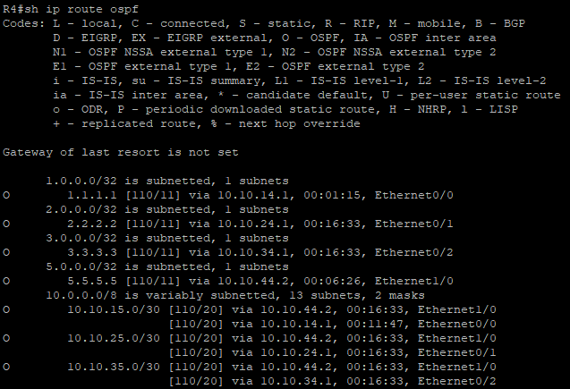
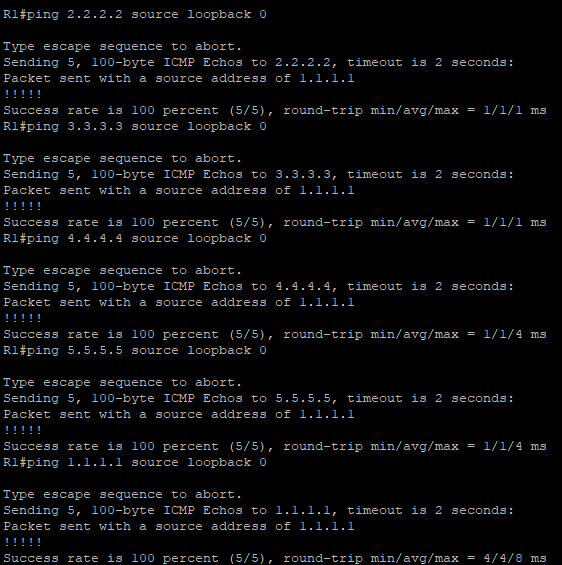

# Lab 02: iBGP Core with Dual Route Reflectors and Dual eBGP Upstreams

**ENCOR domain:** 3.0 Infrastructure
**Topics:** iBGP, route reflectors, peer-groups, OSPF underlay, eBGP, next-hop-self, best-path selection, redundancy
**Environment:** EVE-NG on Proxmox, Cisco IOS (version: \_\_\_)

> \\\\\\\\\\\\\\\\\\\\\\\\\\\\\\\*\\\\\\\\\\\\\\\\\\\\\\\\\\\\\\\*TODO (delete when done):\\\\\\\\\\\\\\\\\\\\\\\\\\\\\\\*\\\\\\\\\\\\\\\\\\\\\\\\\\\\\\\* Everything marked TODO is yours to fill in from your own lab. Replace the placeholders with real outputs, screenshots, and sentences about what you saw.

\---

## Objectives

1. Build an iBGP core (AS 65100) with two route reflectors using a peer-group.
2. Use OSPF as the underlay so iBGP peers can reach each other's loopbacks.
3. Peer eBGP over physical interface addresses toward two parallel upstream providers that converge on one destination AS.
4. Fix next-hop reachability on the route reflectors.
5. Prove that R1, R2, and R3 each see the destination prefix through two different AS-paths.
6. Fail one route reflector and prove the clients keep their routes.
7. Steer traffic toward one upstream with Local Preference and verify it with a traceroute.

## Findings

> \\\\\\\\\\\\\\\\\\\\\\\\\\\\\\\*\\\\\\\\\\\\\\\\\\\\\\\\\\\\\\\*TODO:\\\\\\\\\\\\\\\\\\\\\\\\\\\\\\\*\\\\\\\\\\\\\\\\\\\\\\\\\\\\\\\* Write 3 to 5 one-line results after you finish. Examples of the kind of line to write:
> - What happened to the clients' tables when one RR was shut down.
> - Which upstream path won by default, and which tiebreaker decided it.
> - What changed after the LocPref policy, with the traceroute to prove it.

\---

## Topology

> \\\\\\\\\\\\\\\\\\\\\\\\\\\\\\\*\\\\\\\\\\\\\\\\\\\\\\\\\\\\\\\*TODO:\\\\\\\\\\\\\\\\\\\\\\\\\\\\\\\*\\\\\\\\\\\\\\\\\\\\\\\\\\\\\\\* Add your EVE-NG topology screenshot here.
> `!\\\\\\\\\\\\\\\\\\\\\\\\\\\\\\\[Topology](screenshots/01-topology.png)`

```
                 AS 65100 (iBGP core, OSPF underlay)

        R1 ---------- R4 (RR) ---------- R6 (AS 65200) ----
        R2 ---------- R4 (RR)                                \\\\\\\\\\\\\\\\\\\\\\\\\\\\\\\\
        R3 ---------- R4 (RR)                                 R8 (AS 65400)
         \\\\\\\\\\\\\\\\\\\\\\\\\\\\\\\\             |                                     /
          (each client also links to R5)                     /
        R1 ---------- R5 (RR) ---------- R7 (AS 65300) ----
        R2 ---------- R5 (RR)
        R3 ---------- R5 (RR)

        R4 <----------> R5   (RR to RR link)

        R8 originates 10.200.8.0/24 from Loopback100
```

## Addressing

All point-to-point links use /30 subnets. On each link, the lower-numbered router takes `.1` and the higher-numbered router takes `.2`. Every router has Loopback0 as `10.255.0.N/32`, where N is the router number, and that address is also its BGP router ID.

### Routers

|Router|AS|Role|Loopback0|Notes|
|-|-|-|-|-|
|R1|65100|iBGP client|1.1.1.1/32|peers with R4 and R5|
|R2|65100|iBGP client|2.2.2.2/32|peers with R4 and R5|
|R3|65100|iBGP client|3.3.3.3/32|peers with R4 and R5|
|R4|65100|route reflector|4.4.4.4/32|eBGP to R6|
|R5|65100|route reflector|5.5.5.5/32|eBGP to R7|
|R6|65200|upstream A|6.6.6.6/32|top path|
|R7|65300|upstream B|7.7.7.7/32|bottom path|
|R8|65400|destination|8.8.8.8/32|originates 10.200.8.0/24 (Loopback100)|

### Links

> \\\\\\\\\\\\\\\\\\\\\\\\\\\\\\\*\\\\\\\\\\\\\\\\\\\\\\\\\\\\\\\*TODO:\\\\\\\\\\\\\\\\\\\\\\\\\\\\\\\*\\\\\\\\\\\\\\\\\\\\\\\\\\\\\\\* Fill in the interface column from your own EVE-NG cabling.

|Link|Subnet|Left router (.1)|Right router (.2)|Interfaces|
|-|-|-|-|-|
|R1 to R4|10.10.14.0/30|R1|R4|e0/0|
|R1 to R5|10.10.15.0/30|R1|R5|e0/1|
|R2 to R4|10.10.24.0/30|R2|R4|e0/0|
|R2 to R5|10.10.25.0/30|R2|R5|e0/1|
|R3 to R4|10.10.34.0/30|R3|R4|e0/0|
|R3 to R5|10.10.35.0/30|R3|R5|e0/1|
|R4 to R5|10.10.44.0/30|R4|R5|e1/0|
|R4 to R6|10.10.45.0/30|R4|R6|e0/3|
|R5 to R7|10.10.46.0/30|R5|R7|e0/3|
|R6 to R8|10.10.68.0/30|R6|R8|e0/0|
|R7 to R8|10.10.78.0/30|R7|R8|e0/0|

\---

## Design plan

|Item|Choice|
|-|-|
|IGP|OSPF process 100, area 0, on internal links and loopbacks of R1 to R5 only|
|eBGP links|R4-R6, R5-R7, R6-R8, R7-R8 stay out of OSPF|
|iBGP peering|Loopback to loopback, `update-source Loopback0`|
|iBGP topology|R1, R2, R3 are clients of both R4 and R5|
|RR config|One peer-group on R4 and R5 carrying `remote-as`, `update-source`, `route-reflector-client`, and `next-hop-self`|
|eBGP peering|Physical interface addresses|
|OSPF network type|Point-to-point on the /30 links (see Design decisions)|

\---

## Config highlights

> \\\\\\\\\\\\\\\\\\\\\\\\\\\\\\\*\\\\\\\\\\\\\\\\\\\\\\\\\\\\\\\*TODO:\\\\\\\\\\\\\\\\\\\\\\\\\\\\\\\*\\\\\\\\\\\\\\\\\\\\\\\\\\\\\\\* Paste only the lines that matter, and add one sentence under each saying why. Full files go in `configs/`.

### Route reflector peer-group (R4 and R5)

```
(paste from your R4 config)
```

### iBGP client (R1 to R3)

```
(paste from your R1 config)
```

### eBGP peering (R4 to R6)

```
(paste from your R4 config)
```

### OSPF underlay

```
(paste from your R4 config)
```

\---

## Verification

### 1. Underlay: interface addressing

R4 (route reflector):



R1 (client):



R5 (route reflector):



Each router's links and Loopback0 are up/up with the addresses from the addressing table.

### 2. Underlay: OSPF neighbors

R4:



R5:



Both route reflectors have FULL adjacencies with the three clients and with each other.

### 3. Underlay: routes learned through OSPF

R1:



R4:



OSPF carries the loopbacks of every core router, which is what the iBGP sessions will peer on.

### 4. Underlay: loopback reachability



R1 reaches the other core routers' loopbacks when sourced from its own Loopback0, the same path the iBGP sessions will use.

### 5. iBGP sessions on the route reflectors

(screenshot goes here)

### 6. Client view of the destination prefix (two paths)

(screenshot goes here)

### 7. Next-hop reachability

(screenshot goes here)

### 8. Reflected route attributes

(screenshot goes here)

### 9. Redundancy test

(screenshot goes here)

### 10. Local Preference steering

(screenshot goes here)
## Troubleshooting: bugs found and fixed

> \\\\\\\\\\\\\\\\\\\\\\\\\\\\\\\*\\\\\\\\\\\\\\\\\\\\\\\\\\\\\\\*TODO:\\\\\\\\\\\\\\\\\\\\\\\\\\\\\\\*\\\\\\\\\\\\\\\\\\\\\\\\\\\\\\\* Keep a Notepad log while you build and paste each problem here. This section is the most valuable part of the lab.

### Bug 1: Missing BGP Update-Source for Loopback Peering

Symptom: Without update-source Loopback0, sessions between loopback addresses fail, because the source address doesn’t match the neighbor statement
Root cause: By default, when initiating a TCP connection to a peer loopback address, the router uses its physical exit interface IP (such as a /30 link IP) as the source address. The remote router rejects the packet because the incoming source IP does not match the expected neighbor statement, keeping the session stuck in Idle or Active
Fix: Configured neighbor RR-CLIENTS update-source Loopback0 under router bgp 65100 on both the route reflectors and clients to force outgoing BGP packets to source from Loopback0.

\---

## Design decisions

> \\\\\\\\\\\\\\\\\\\\\\\\\\\\\\\*\\\\\\\\\\\\\\\\\\\\\\\\\\\\\\\*TODO:\\\\\\\\\\\\\\\\\\\\\\\\\\\\\\\*\\\\\\\\\\\\\\\\\\\\\\\\\\\\\\\* Answer each question in your own words, with evidence from the lab.

* **Where does `next-hop-self` go, and why on the route reflectors instead of the clients?**
* **Should R4 and R5 peer with each other, and as clients or non-clients?**
* **One cluster ID or two for the RRs?** What does each choice do to redundancy and to the number of duplicate paths the clients hold?
* **Why `ip ospf network point-to-point` on the /30 links?** On Ethernet, OSPF defaults to broadcast and elects a DR and BDR, which a two-router link does not need.
* **Which path did the clients pick when both upstream paths were equal, and which tiebreaker decided it?**

\---

## Files

|Folder|Contents|
|-|-|
|`configs/`|Final running configs, `R1.cfg` to `R8.cfg`|
|`verification/`|`show` command output as text files|
|`screenshots/`|Topology and annotated screenshots|
|`capture/`|Packet captures, if any|


