# Lab 02: iBGP Core with Dual Route Reflectors and Dual eBGP Upstreams

**ENCOR domain:** 3.0 Infrastructure
**Topics:** iBGP, route reflectors, peer-groups, OSPF underlay, eBGP, next-hop-self, best-path selection, redundancy
**Environment:** EVE-NG on Proxmox, Cisco IOL (i86bi-linux-l3-p-15.0b, IOS 15.0)

\---

## Objectives

1. Build an iBGP core (AS 65100) with two route reflectors using a peer-group.
2. Use OSPF as the underlay so iBGP peers can reach each other's loopbacks.
3. Peer eBGP over physical interface addresses toward two parallel upstream providers that converge on one destination AS.
4. Fix next-hop reachability on the route reflectors.
5. Prove that R1, R2, and R3 each see the destination prefix through two different AS-paths.
6. Fail one route reflector and prove the clients keep their routes.
7. Steer traffic toward one upstream with Local Preference and verify it with a traceroute.

## Findings

> - What happened to the clients' tables when one RR was shut down.
> - Which upstream path won by default, and which tiebreaker decided it.
> - What changed after the LocPref policy, with the traceroute to prove it.

\---

## Topology


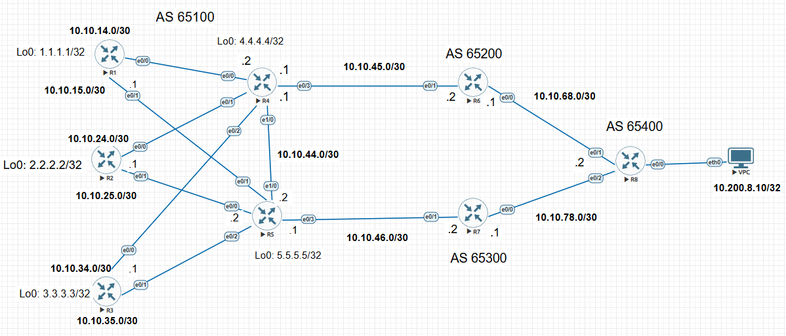


## Addressing

All point-to-point links use /30 subnets. On each link, the lower-numbered router takes `.1` and the higher-numbered router takes `.2`. Every router has Loopback0 as `N.N.N.N/32`, where N is the router number, and that address is also its BGP router ID.

### Routers

| Router | AS | Role | Loopback0 | Notes |
|---|---|---|---|---|
| R1 | 65100 | iBGP client | 1.1.1.1/32 | peers with R4 and R5; originates its loopback for return traffic |
| R2 | 65100 | iBGP client | 2.2.2.2/32 | peers with R4 and R5 |
| R3 | 65100 | iBGP client | 3.3.3.3/32 | peers with R4 and R5 |
| R4 | 65100 | route reflector | 4.4.4.4/32 | eBGP to R6 |
| R5 | 65100 | route reflector | 5.5.5.5/32 | eBGP to R7 |
| R6 | 65200 | upstream A | 6.6.6.6/32 | top path |
| R7 | 65300 | upstream B | 7.7.7.7/32 | bottom path |
| R8 | 65400 | destination | 8.8.8.8/32 | originates 10.200.8.0/24 from the LAN port facing the VPC |

### Links

| Link | Subnet | Left router (.1) | Right router (.2) | Left interface | Right interface |
|---|---|---|---|---|---|
| R1 to R4 | 10.10.14.0/30 | R1 | R4 | e0/0 | e0/0 |
| R1 to R5 | 10.10.15.0/30 | R1 | R5 | e0/1 | e0/1 |
| R2 to R4 | 10.10.24.0/30 | R2 | R4 | e0/0 | e0/1 |
| R2 to R5 | 10.10.25.0/30 | R2 | R5 | e0/1 | e0/0 |
| R3 to R4 | 10.10.34.0/30 | R3 | R4 | e0/0 | e0/2 |
| R3 to R5 | 10.10.35.0/30 | R3 | R5 | e0/1 | e0/2 |
| R4 to R5 | 10.10.44.0/30 | R4 | R5 | e1/0 | e1/0 |
| R4 to R6 | 10.10.45.0/30 | R4 | R6 | e0/3 | e0/1 |
| R5 to R7 | 10.10.46.0/30 | R5 | R7 | e0/3 | e0/1 |
| R6 to R8 | 10.10.68.0/30 | R6 | R8 | e0/0 | e0/1 |
| R7 to R8 | 10.10.78.0/30 | R7 | R8 | e0/0 | e0/2 |
| R8 to VPC | 10.200.8.0/24 | R8 (.1) | VPC (.10) | e0/0 | eth0 |

---

## Design plan

|Item|Choice|
|-|-|
|IGP|OSPF process 100, area 0, on internal links and loopbacks of R1 to R5 only|
|eBGP links|R4-R6, R5-R7, R6-R8, R7-R8 stay out of OSPF|
|iBGP peering|Loopback to loopback, `update-source Loopback0`|
|iBGP topology|R1, R2, R3 are clients of both R4 and R5|
|RR config|One peer-group on R4 and R5 carrying `remote-as`, `update-source`, `route-reflector-client`, and `next-hop-self`|
|eBGP peering|Physical interface addresses|
|OSPF network type|Point-to-point on the /30 links (see Design decisions)|

\---

## Config highlights

* Full configs are in `configs/`. Only the lines that matter are shown here.
  
### Route reflector peer-group (R4)

```
router bgp 65100
 bgp router-id 4.4.4.4
 neighbor RR-CLIENTS peer-group
 neighbor RR-CLIENTS remote-as 65100
 neighbor RR-CLIENTS update-source Loopback0
 neighbor RR-CLIENTS route-reflector-client
 neighbor RR-CLIENTS next-hop-self
 neighbor 1.1.1.1 peer-group RR-CLIENTS
 neighbor 2.2.2.2 peer-group RR-CLIENTS
 neighbor 3.3.3.3 peer-group RR-CLIENTS
 neighbor 5.5.5.5 remote-as 65100
 neighbor 5.5.5.5 update-source Loopback0
 neighbor 5.5.5.5 next-hop-self
```

* The peer-group holds the settings shared by all three clients: loopback peering, the reflector role, and `next-hop-self`. R4 and R5 peer with each other as a normal iBGP neighbor outside the group, so they are not clients of each other. R5 uses the same group with its own router ID (5.5.5.5).
  
### iBGP client (R1)

```
router bgp 65100
 bgp router-id 1.1.1.1
 bgp log-neighbor-changes
 network 1.1.1.1 mask 255.255.255.255
 neighbor 4.4.4.4 remote-as 65100
 neighbor 4.4.4.4 update-source Loopback0
 neighbor 5.5.5.5 remote-as 65100
 neighbor 5.5.5.5 update-source Loopback0
```
* Clients need no reflector configuration. R1 peers with both route reflectors over loopbacks and advertises its own loopback, so replies from the VPC have a route back.

### eBGP peering (R4 to R6)

```
router bgp 65100
 neighbor 10.10.45.2 remote-as 65200
```
* eBGP uses the directly connected link address, so no `update-source` or multihop is needed. R5 does the same toward R7 (10.10.46.2, AS 65300).

### OSPF underlay (R4)

```
router ospf 100
 router-id 4.4.4.4
 network 4.4.4.4 0.0.0.0 area 0
 network 10.10.14.0 0.0.0.3 area 0
 network 10.10.24.0 0.0.0.3 area 0
 network 10.10.34.0 0.0.0.3 area 0
 network 10.10.44.0 0.0.0.3 area 0
!
interface Ethernet 0/0-2 , 1/0 
 ip ospf network point-to-point
```
* OSPF carries R4's loopback and its four internal links in area 0. R4's link to R6 (10.10.45.0/30) is left out on purpose, so external link subnets stay out of the IGP. The same `point-to-point` line is on Ethernet 0/0, Ethernet0/1, Ethernet0/2, and Ethernet1/0, which skips the DR/BDR election on two-router links.


\---

## Verification

### 1. Underlay: interface addressing

R4 (route reflector):

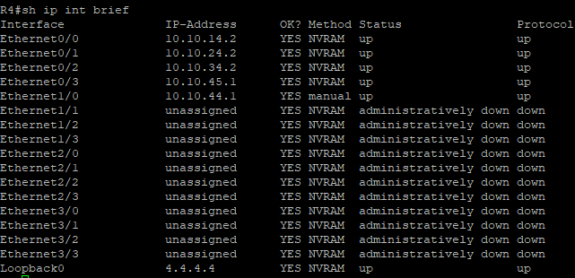

R1 (client):

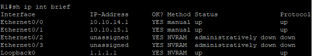

R5 (route reflector):

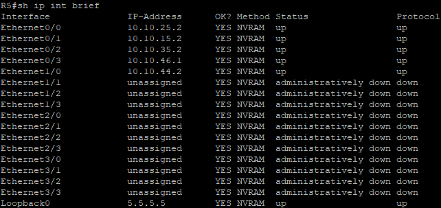

Each router's links and Loopback0 are up/up with the addresses from the addressing table.

### 2. Underlay: OSPF neighbors

R4:

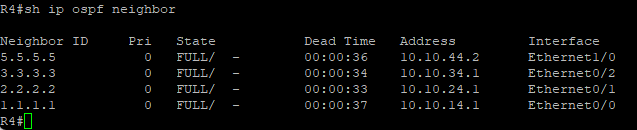

R5:

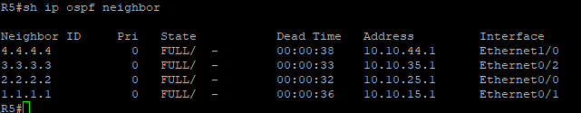

Both route reflectors have FULL adjacencies with the three clients and with each other.

### 3. Underlay: routes learned through OSPF

R1:

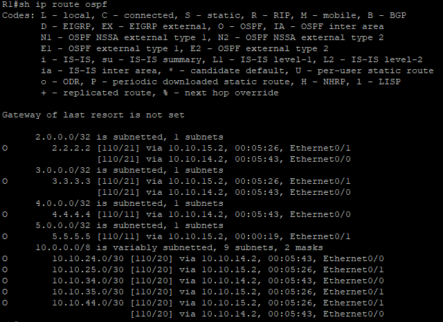

R4:

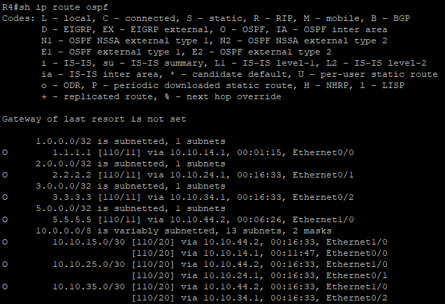

* OSPF carries the loopbacks of every core router, which is what the iBGP sessions will peer on.

### 4. Underlay: loopback reachability

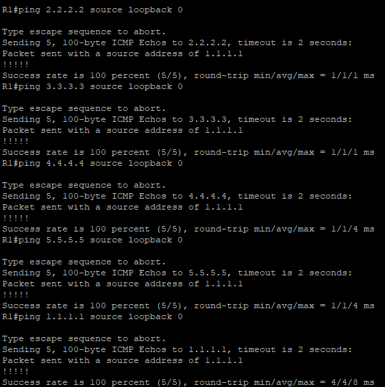

* R1 reaches the other core routers' loopbacks when sourced from its own Loopback0, the same path the iBGP sessions will use.

### 5. iBGP sessions on the route reflectors

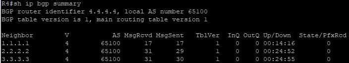

* R4 has all three clients Established. The last column is the prefix count (0 for now), not a state, because no external routes have been advertised yet.

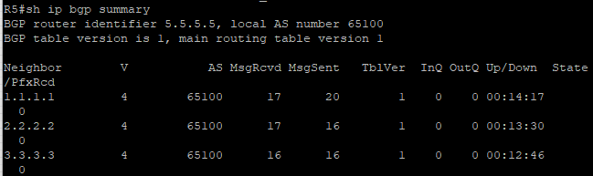

* R5 shows the same three clients Established, so both route reflectors serve the same client set.

* After eBGP came up, R4's summary also shows its eBGP neighbor and the prefix counts:

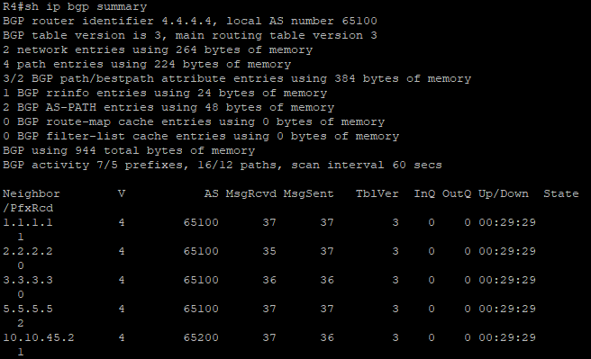


* R4 now has five Established neighbors: the three clients, R5, and R6 (AS 65200) over the physical link address. R1 and R6 each send one prefix, R5 sends two, and R2 and R3 send none because they originate nothing.


### 6. Client view of the destination prefix (two paths)

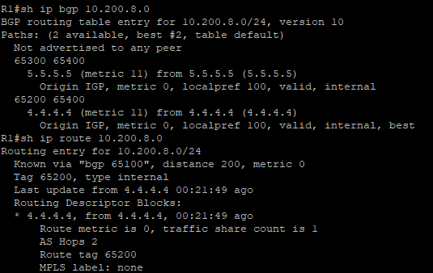
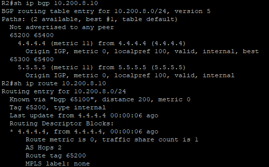
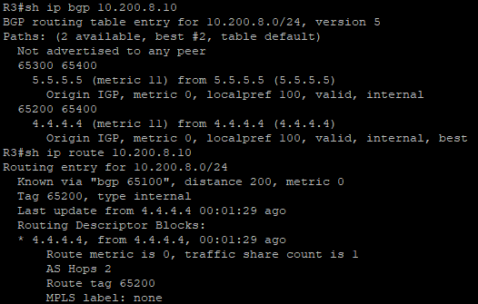


* R1 learns 10.200.8.0/24 from both route reflectors, so it holds two paths: one through R5 (AS-path 65300 65400) and one through R4 (AS-path 65200 65400). Both have LocPref 100, the same AS-path length, and the same IGP metric (11) to their next hops. Lowest router ID breaks the tie, so R4's path (4.4.4.4) is best. The routing table installs it as an iBGP route with administrative distance 200.

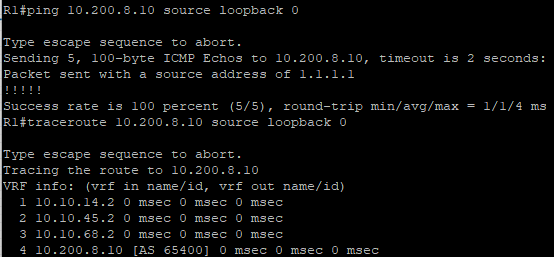

* The ping from R1's Loopback0 succeeds, and the traceroute shows the path R1 actually uses: R4 (10.10.14.2), R6 (10.10.45.2), R8 (10.10.68.2), then the VPC. That matches the best path through R4 and upstream AS 65200.

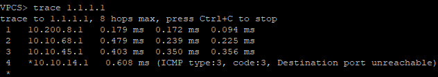

* The VPC's trace back to R1 goes through R8, R6, and R4, the same path R1 uses to reach the VPC, so the traffic is symmetric. The last line is R1 answering with "destination port unreachable", which is how a VPCS trace shows that the probe reached its target.

### 7. Next-hop reachability

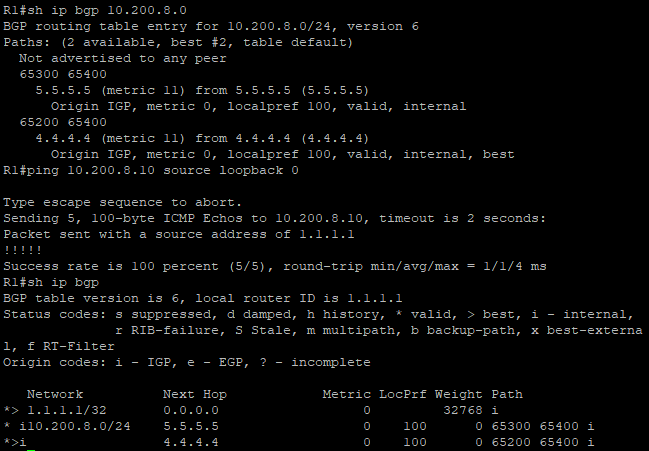

* R4 and R5 learn 10.200.8.0/24 over eBGP, so the next hop starts out as the upstream's link address (R6 or R7), and iBGP does not rewrite it. Those link subnets are not in OSPF, so the clients cannot reach them. With `next-hop-self` on the route reflectors, R1 sees the RRs' loopbacks (4.4.4.4 and 5.5.5.5) as next hops, both reachable at IGP metric 11, so R1 selects a best path and the ping to the VPC succeeds.

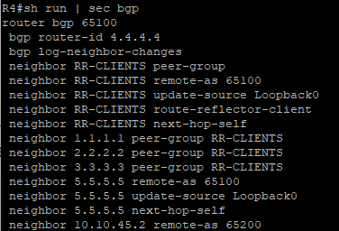

`next-hop-self` is applied once on the RR-CLIENTS peer-group, so all three clients get it. It is also set on the R4-to-R5 session, so each route reflector's backup copy of the path has a next hop its peer can reach.

### 8. Reflected route attributes

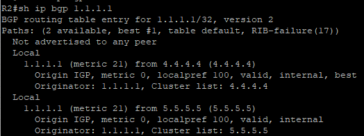

* R2 has no BGP session with R1, so it learns 1.1.1.1/32 through the route reflectors. The route arrives twice, once from R4 and once from R5. Each copy carries an Originator of 1.1.1.1 (R1's router ID, the client that first advertised it) and a Cluster list holding the reflecting router's cluster ID (4.4.4.4 for R4's copy, 5.5.5.5 for R5's). These attributes appear only on reflected routes, which shows the route reflectors are doing the work. Both paths tie on every attribute and on the IGP metric (21), and R4's copy is marked best.

*The header also says RIB-failure(17). R2 does not install the BGP route because OSPF already provides 1.1.1.1/32 with a lower administrative distance.


### 9. Redundancy test

* Before the failure, R1 holds two paths to 10.200.8.0/24, one through each route reflector (see section 6). Then the R4 node was stopped completely.

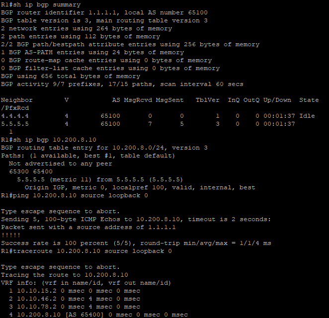

* R1's session to R4 (4.4.4.4) dropped to Idle with no messages exchanged, while the session to R5 (5.5.5.5) stayed Established. The route to 10.200.8.0/24 is still in R1's table, now as a single path through R5 (AS-path 65300 65400), so it is the best path. The ping from R1's Loopback0 to the VPC still succeeds (5/5), and the traceroute now goes through R5, R7, and R8 instead of R4, R6, and R8.

* With two route reflectors, losing one does not cost the clients any routes. R1 has a session to each, and each one already had the route.


### 10. Local Preference steering

* By default, R1 chooses between two equal upstream paths by tiebreaker. To choose deliberately, R5 sets Local Preference 200 on routes received from R7, so the whole AS prefers the path through R7.

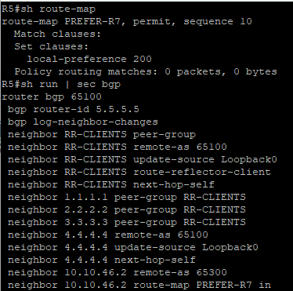
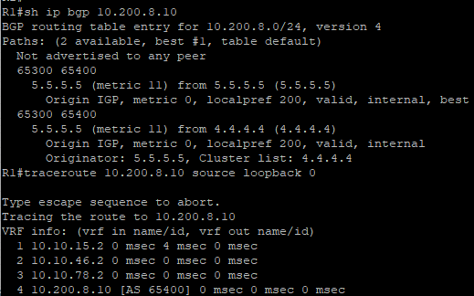


* R1's path through R5 now carries LocPref 200 and is best. Local Preference is shared across iBGP, so the policy is configured once on the edge router and every router in AS 65100 follows it. R1's traceroute to the VPC now goes through R5, R7, and R8.

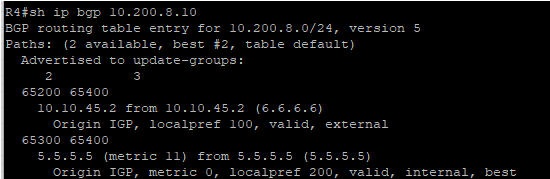

* R4 also prefers R5's path, even though it has its own eBGP path through R6. Local Preference is checked before the eBGP-over-iBGP rule, so R4 sends traffic across to R5 and out through R7.

## Troubleshooting: bugs found and fixed


### Bug 1: Missing BGP Update-Source for Loopback Peering

* **Symptom:** Without `update-source Loopback0`, sessions between loopback addresses fail because the source address doesn’t match the neighbor statement
* **Root cause:** By default, when initiating a TCP connection to a peer loopback address, the router uses its physical exit interface IP (such as a `/30` link IP) as the source address. The remote router rejects the packet because the incoming source IP does not match the expected neighbor statement, keeping the session stuck in Idle or Active.
* **Fix:** Configured `neighbor RR-CLIENTS update-source Loopback0` under `router bgp 65100` on both the route reflectors and clients to force outgoing BGP packets to source from Loopback0.

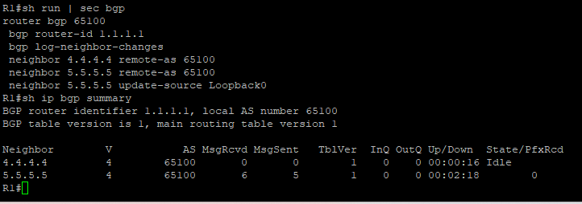
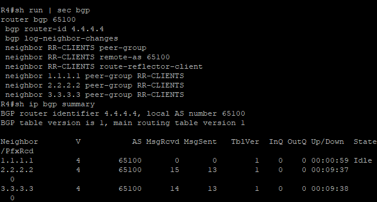
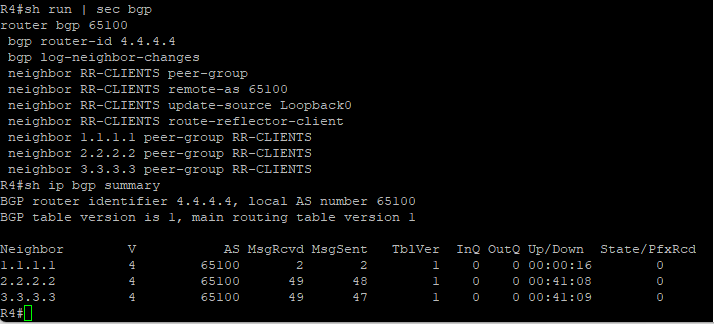


### Bug 2: Next hops unreachable on the clients

* **Symptom:** R1 showed 10.200.8.0/24 with two paths, but `no best path`, and both next hops were marked `(inaccessible)`. A ping from R1's Loopback0 to the VPC failed (0/5).
* **Root cause:** R4 and R5 learn the prefix over eBGP, so the next hops are R6's and R7's link addresses (10.10.45.2 and 10.10.46.2). iBGP does not rewrite the next hop, and those eBGP link subnets are deliberately kept out of OSPF, so R1 had no route to either next hop and could not use either path.
* **Fix:** Applied `next-hop-self` to the RR-CLIENTS peer-group on R4 and R5, then ran `clear ip bgp * soft out`. R1's paths now use 4.4.4.4 and 5.5.5.5 as next hops, a best path is selected, and the ping succeeds. (Reproduced for the screenshots by removing the line, then restoring it.)

Broken state:

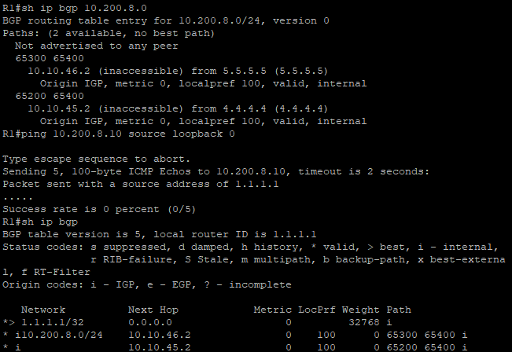

After the fix:


### Bug 3: Ping to the VPC failed even though R1 had the route

* **Symptom:** R1 had 10.200.8.0/24 in its BGP table with a best path, but a ping from R1's Loopback0 to the VPC failed (0/5), and the traceroute stopped after the first hop or two.
* **Root cause:** The forward path was fine, but R8 had no route back to R1's loopback (1.1.1.1). Nothing was advertising it into BGP, and the core's OSPF is invisible to the upstream ASes, so R8 dropped the replies. A BGP table entry only describes the forward direction.
* **Fix:** Restored `network 1.1.1.1 mask 255.255.255.255` on R1, so the loopback propagates through the route reflectors and upstreams to R8. The ping then succeeded. (Reproduced for the screenshots by removing the line, then restoring it.)

Broken state:

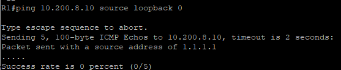

R8 has no route to 1.1.1.1:

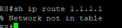

After the fix:

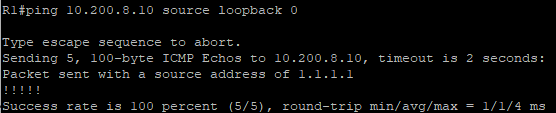
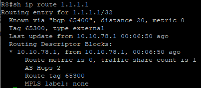


---

## Design decisions


* **Where does `next-hop-self` go, and why on the route reflectors instead of the clients?**
* On R4 and R5, because they are the routers that learn the external prefix over eBGP and pass it into iBGP. Without it the clients received R6's and R7's link addresses as next hops, and with those subnets kept out of OSPF the paths were inaccessible (Bug 2). Configuring it once on the RRs' peer-group fixes every client without touching their configs and keeps external link subnets out of the IGP. The alternative is advertising those link subnets into OSPF, which spreads external addressing through the core.

* **Should R4 and R5 peer with each other, and as clients or non-clients?**
* They peer as ordinary iBGP neighbors outside the RR-CLIENTS peer-group, so neither is a client of the other. Each RR learns only its own upstream's path over eBGP, and the peering gives it the other RR's path as a backup. R4's table showed the path through R5 as the standby, and when its link to R6 was shut it switched to that path.

* **One cluster ID or two for the RRs?** What does each choice do to redundancy and to the number of duplicate paths the clients hold?
*  I used the default, so each RR uses its own router ID as its cluster ID (two cluster IDs). Section 8 shows this: the Cluster list is 4.4.4.4 on the copy reflected by R4 and 5.5.5.5 on the copy reflected by R5. R2 holds a copy from each RR, and that is what let R1 keep its route when R4 went down. With a shared cluster ID, each RR would reject routes the other had reflected (it would see its own cluster ID), which reduces duplicate paths on the RRs; the clients would still hold a copy from each RR, because each one peers with both.
  
* **Why `ip ospf network point-to-point` on the /30 links?** On Ethernet, OSPF defaults to broadcast and elects a DR and BDR, which a two-router link does not need.
*  Ethernet interfaces default to the broadcast network type, so OSPF elects a DR and BDR even on a link with only two routers. Point-to-point skips that election. R4's neighbor table shows `FULL/ -` with priority 0, which means no DR or BDR was elected on those links.
  
* **Which path did the clients pick when both upstream paths were equal, and which tiebreaker decided it?**
*   R1 held two iBGP paths to 10.200.8.0/24, one through each RR. LocPref (100), AS-path length (2), and IGP metric (11) were all equal, and both paths were iBGP, so the oldest-path rule did not apply. The lowest router ID decided it: R4's 4.4.4.4 beat R5's 5.5.5.5.

\---

## Files

|Folder|Contents|
|-|-|
|`configs/`|Final running configs, `R1.cfg` to `R8.cfg`|
|`verification/`|`show` command output as text files|
|`screenshots/`|Topology and annotated screenshots|
|`capture/`|Packet captures, if any|


